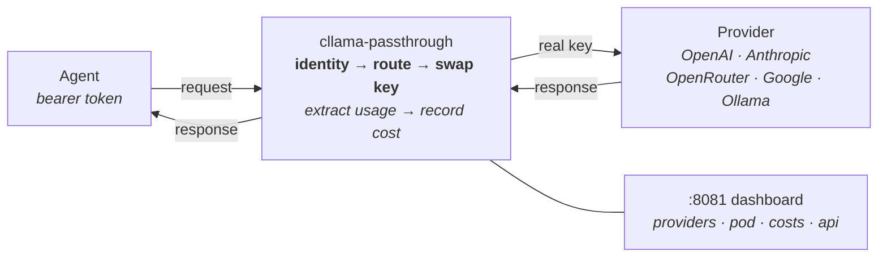
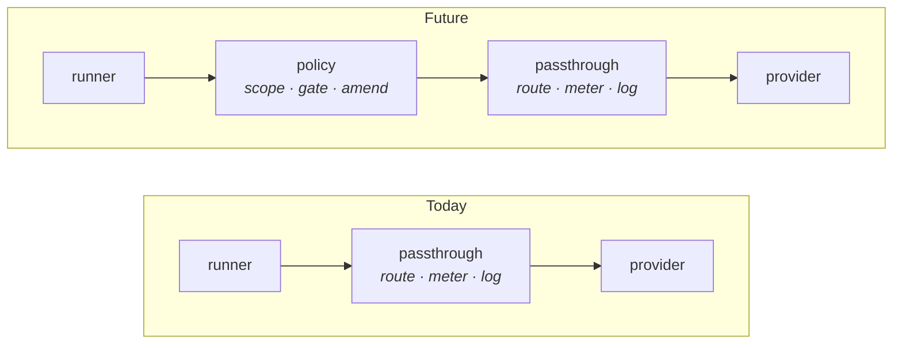

# 

**The blood-brain barrier for autonomous agents.**

`cllama` is the reference implementation of the [cllama proxy standard](https://github.com/mostlydev/clawdapus/blob/master/docs/CLLAMA_SPEC.md) — a context-aware, bidirectional LLM governance proxy that enforces **credential starvation** on untrusted agent workloads.

It is a single Go binary with zero dependencies. 15 MB distroless image. Two ports: `:8080` for the OpenAI-compatible API, `:8081` for the operator dashboard. Every agent request is identity-verified, provider-routed, cost-tracked, and audit-logged — transparently. The agent never knows the proxy exists.



---

## The Architecture

A `cllama` proxy sits between the runner (the agent's application code) and the LLM provider. In the [Clawdapus](https://github.com/mostlydev/clawdapus) architecture, agents are treated as untrusted workloads — containers that can think, but whose compute access is a privilege granted by the operator, not a right assumed by the process.

**Credential starvation** is the enforcement mechanism. The agent container is provisioned with a unique bearer token (`<agent-id>:<48-hex-secret>`). The proxy holds the real provider API keys. Because the agent lacks the credentials to call providers directly, all inference *must* transit the proxy — even if a compromised agent tries to bypass its configured base URL.

The "passthrough" reference performs no cognitive mutation. It verifies identity, routes to the correct upstream, swaps credentials, streams the response, extracts token usage, and records cost. Future proxy types (`cllama-policy`) will add bidirectional interception — evaluating outbound prompts against the agent's behavioral contract, and amending or dropping inbound responses that drift from purpose.

### Request lifecycle

```
1.  Agent sends POST /v1/chat/completions
    Authorization: Bearer tiverton:a1b2c3d4e5f6...
    {"model": "anthropic/claude-sonnet-4", "messages": [...]}

2.  Identity resolution
    Parse bearer token → load /claw/context/tiverton/metadata.json
    Validate secret (constant-time comparison)

3.  Provider routing
    Split model on "/" → provider=anthropic, model=claude-sonnet-4
    Look up provider config → base_url, auth scheme, real API key

4.  Credential swap
    Strip agent's bearer token
    Inject real key (Bearer, X-Api-Key, or none — per provider)

5.  Forward + stream
    Proxy request to upstream, stream response back transparently

6.  Cost extraction
    Parse usage from response body (JSON or SSE stream)
    Multiply by pricing table → record per (agent, provider, model)

7.  Audit log
    Emit structured JSON to stdout: timestamp, agent, model,
    latency, status, tokens_in, tokens_out, cost_usd, intervention
```

---

## Building

```bash
# Binary
go build -o cllama ./cmd/cllama

# Docker (~15 MB distroless)
docker build -t ghcr.io/mostlydev/cllama:latest .

# Stamp the version the trace journal records (unstamped builds record dev/unknown)
docker build --build-arg CLLAMA_VERSION=v0.X.Y --build-arg CLLAMA_REVISION=$(git rev-parse HEAD) -t ghcr.io/mostlydev/cllama:v0.X.Y .
```

Zero external dependencies. Go standard library only.

---

## Running

```bash
./cllama
```

Or with Docker:

```bash
docker run -p 8080:8080 -p 8081:8081 \
  -e ANTHROPIC_API_KEY=sk-ant-... \
  -e OPENROUTER_API_KEY=sk-or-... \
  -e GEMINI_API_KEY=sk-gemini-... \
  -v ./context:/claw/context:ro \
  ghcr.io/mostlydev/cllama:latest
```

---

## Configuration

### Environment

| Variable | Default | Purpose |
|---|---|---|
| `LISTEN_ADDR` | `:8080` | API server |
| `UI_ADDR` | `:8081` | Operator dashboard |
| `CLAW_CONTEXT_ROOT` | `/claw/context` | Per-agent context mount |
| `CLAW_AUTH_DIR` | `/claw/auth` | Provider credentials |
| `CLAW_POD` | | Pod name (dashboard display) |
| `CLAW_SESSION_HISTORY_DIR` | `/claw/session-history` | Per-agent JSONL session history base dir. When set, cllama appends one entry per successful 2xx upstream completion to `<dir>/<agent-id>/history.jsonl`. |
| `CLLAMA_TRACE_JOURNAL` | `off` | Set to `on` to write the [trace journal](#trace-journal). Requires `CLAW_SESSION_HISTORY_DIR`. |
| `CLLAMA_TRACE_OWNER` | _(empty)_ | `<uid>:<gid>` that owns journal directories and segments, so a host collector can read and remove them. cllama refuses to start if it cannot apply it or the collector could not traverse the history directory. |
| `CLLAMA_TRACE_MAX_FIELD_BYTES` | `1048576` | Largest captured body recorded verbatim; larger bodies become a size marker. |
| `CLLAMA_TRACE_MAX_SEGMENT_BYTES` | `67108864` | Per-segment capture budget; later bodies become size markers. |
| `CLLAMA_FEED_MAX_RESPONSE_BYTES` | `32768` | Maximum bytes read from any single feed response before truncation. |
| `CLLAMA_FEED_MAX_TOTAL_BYTES` | `65536` | Maximum aggregate bytes of formatted feed blocks injected into one request. |
| `CLLAMA_FEED_FETCH_TIMEOUT_MS` | `3000` | Per-fetch HTTP timeout for feed providers (sanity range 100–120000; invalid values fall back to default). Raise it when a feed provider computes synchronously under load. |
| `CLLAMA_TOOL_ARG_PRUNE_SENTINELS` | _(empty)_ | Comma-separated `<provider>/<model-prefix>` entries selecting models whose optional tool arguments should be dropped when their value is exactly the schema's `minimum`. Empty disables it. Some model families populate every optional parameter rather than omitting unasked-for ones and reach for the lower bound as filler, which turns valid calls into rejected ones downstream. Lossy by construction, and model-scoped rather than global because whether it is correct depends on which model emitted the argument. Independent of `CLLAMA_TOOL_SCHEMA_VALIDATION`. |
| `CLLAMA_TOOL_SCHEMA_VALIDATION` | `on` | Set to `off` to disable pre-dispatch validation of managed tool arguments against the manifest `inputSchema`. Emergency rollback knob; validation fails open on schema constructs it does not understand. |
| `CLLAMA_RESPONSES_API_MODELS` | | Extra provider-scoped model prefixes to dispatch through the Responses API, comma-separated as `<provider>/<model-prefix>` (e.g. `openai/gpt-6`). Adds to the built-in set; see [Responses API adapter](#responses-api-adapter). |
| `CLLAMA_RESPONSES_API_DISABLED` | `off` | Set to `1` to disable the Responses API adapter entirely. Escape hatch for when a model no longer needs it. |
| `CLLAMA_RESPONSES_DEFAULT_REASONING_EFFORT` | _(empty)_ | Reasoning effort injected into Responses-adapted requests that omit `reasoning_effort`. Explicit caller values always win. Accepted values: `none`, `minimal`, `low`, `medium`, `high` (case-insensitive); an invalid value skips injection and emits a `responses_reasoning_effort_invalid:<value>` intervention instead of poisoning every adapted request. Applied defaults emit `responses_reasoning_effort_defaulted:<value>`. |
| `CLLAMA_RESPONSES_REQUIRED_TOOL_CHOICE_AS_AUTO` | `off` | Set to `1` to relax a caller's `tool_choice: "required"` to `"auto"` at the Responses adapter boundary. Opt-in escape hatch for runtimes that apply chat-only tool policy to scheduled turns. Every applied rewrite emits a `responses_required_tool_choice_relaxed` intervention — the mutation is never silent. |
| `OPENAI_API_KEY` | | Provider key override |
| `ANTHROPIC_API_KEY` | | Provider key override |
| `OPENROUTER_API_KEY` | | Provider key override |
| `GEMINI_API_KEY` | | Primary Google Gemini provider key override |
| `GOOGLE_API_KEY` | | Lower-priority alias for the Google Gemini provider key |
| `GOOGLE_BASE_URL` | | Override for Google's OpenAI-compatible base URL |
| `AI_GATEWAY_API_KEY` | | Vercel AI Gateway provider key override |
| `AI_GATEWAY_BASE_URL` | `https://ai-gateway.vercel.sh/v1` | Override for Vercel AI Gateway's OpenAI-compatible base URL |
| `META_API_KEY` | | Meta (`meta/<model>`, e.g. `meta/muse-spark-1.3`) provider key override |
| `META_BASE_URL` | `https://api.meta.ai/v1` | Override for Meta's OpenAI-compatible base URL |

Environment variables override keys saved via the web UI.

When cllama runs under Clawdapus, set feed budget variables through
`x-claw.cllama-defaults.env` or service-level `x-claw.cllama-env`. The defaults
stay intentionally bounded for small pods; larger Discord or market-context
windows should raise both the per-feed and aggregate caps together.

For Vercel AI Gateway routing, declare models as `vercel/<provider>/<model>`,
for example `vercel/anthropic/claude-sonnet-4.6`. cllama forwards the model
suffix to Vercel's OpenAI-compatible endpoint. The Anthropic `/v1/messages`
path remains native Anthropic-only.

### Agent context

Each agent is a subdirectory under `CLAW_CONTEXT_ROOT`:

```
/claw/context/
├── tiverton/
│   ├── metadata.json     # bearer token, pod, service, type
│   ├── AGENTS.md         # behavioral contract
│   ├── CLAWDAPUS.md      # infrastructure map
│   ├── tools.json        # optional managed-tool manifest
│   └── context-blocks.json     # optional runtime context blocks
├── westin/
│   └── ...
└── allen/
    └── ...
```

`metadata.json`:
```json
{
  "token": "tiverton:a1b2c3d4e5f6a1b2c3d4e5f6a1b2c3d4e5f6a1b2c3d4e5f6",
  "pod": "trading-desk",
  "service": "tiverton",
  "type": "openclaw"
}
```

When orchestrated by Clawdapus, `claw up` generates all of this — tokens via `crypto/rand`, context from the pod manifest, provider keys injected only into the proxy env.

If `context-blocks.json` is present, cllama injects enabled `every_turn` blocks
as distinct runtime-context segments. Blocks may render before or after feeds,
with the default placement after feeds and before time context. The original
system prompt remains unchanged.

Managed tools may opt into terminal-on-success behavior with the namespaced
annotation `"x-claw.terminalOnSuccess": true` in `tools.json`. After an
annotated call returns a 2xx response whose normalized managed envelope has
top-level `ok: true`, cllama records the receipt and ends the mediated turn with
a protocol-valid empty assistant response instead of requesting another model
round. A terminal-on-success call must be the final tool call in its round; an
invalid order is rejected before any tool executes. Failed annotated calls and
unannotated tools retain the normal recovery loop. The annotation value must be
a JSON boolean; other value types are ignored and logged as invalid.

### Provider registry

`providers.json` in `CLAW_AUTH_DIR`:

```json
{
  "providers": {
    "anthropic": {
      "base_url": "https://api.anthropic.com/v1",
      "api_key": "sk-ant-...",
      "auth": "x-api-key"
    },
    "openrouter": {
      "base_url": "https://openrouter.ai/api/v1",
      "api_key": "sk-or-...",
      "auth": "bearer"
    },
    "google": {
      "base_url": "https://generativelanguage.googleapis.com/v1beta/openai",
      "api_key": "sk-gemini-...",
      "auth": "bearer"
    },
    "ollama": {
      "base_url": "http://ollama:11434/v1",
      "auth": "none"
    }
  }
}
```

Auth schemes: `bearer` (OpenAI, OpenRouter, Google), `x-api-key` (Anthropic), `none` (Ollama, local models).

---

## Operator Dashboard

Built-in web UI on `:8081`. No JavaScript frameworks, no build step — Go templates compiled into the binary.

| Page | Path | Function |
|---|---|---|
| Providers | `/` | Manage upstream provider configs. Routing diagram. Add/update/delete. |
| Pod | `/pod` | Agent cards — type, request count, cost, models used. |
| Costs | `/costs` | Real-time spend. Total banner, per-agent breakdown, nested model detail. |
| Costs API | `/costs/api` | JSON. Pipe to Grafana, alerting, `jq`, or the Master Claw. |

Cost state is in-memory — resets on restart. Structured logs on stdout are the durable audit record.

---

## API Surface

**`:8080` — Proxy API**

| Method | Path | Description |
|---|---|---|
| `POST` | `/v1/chat/completions` | OpenAI-compatible chat completions |
| `POST` | `/v1/messages` | Anthropic Messages API (native format) |
| `GET` | `/health` | `{"ok": true}` |

Both endpoints support streaming. The Anthropic endpoint forwards `Anthropic-Version` and `Anthropic-Beta` headers and uses `X-Api-Key` authentication automatically.

### Responses API adapter

OpenAI's newest models reject function tools on `/v1/chat/completions` and are
reachable only through `POST /v1/responses`. Rather than exposing a second
inbound surface, cllama keeps its agent-facing contract at
`/v1/chat/completions` and translates at the **provider boundary**: for models
that require it, the outbound request is re-encoded as a Responses call and the
reply is translated back to the chat/completions shape before anything else sees
it.

Runners need no changes, and every governance surface — audit events, session
history, budget accounting, managed tool mediation, candidate failover — keeps
observing the unchanged chat/completions shape. Requests routed this way emit an
`intervention` audit event with reason `responses_api_adapter`.

Selection is per declared provider/model:

- **Built in:** `openai/gpt-5.6*`, `openai/gpt-5-pro*`, and the exact OpenAI
  families `gpt-6.1-sol`, `gpt-6-astra`, `gpt-6-sol`, `gpt-6-luna` plus their
  dated snapshots. GPT6 tool calling uses Responses; unknown sibling names
  and other providers are unaffected.
- **Extend** with `CLLAMA_RESPONSES_API_MODELS`.
- **Recover automatically:** when upstream rejects a request with a message
  naming `/v1/responses`, that request is retried once through the adapter and
  emits `responses_api_adapter_retry`. This covers models OpenAI moves before
  the built-in list catches up, instead of surfacing a rejection that reads like
  a credentials problem.
- **Disable** with `CLLAMA_RESPONSES_API_DISABLED=1`.

Two behaviours are worth knowing:

- Requests are dispatched **non-streaming** upstream, because the Responses
  event taxonomy differs from chat SSE. An agent that asked for a stream
  receives synthetic chat SSE built from the buffered completion.
- The adapter sends `store: false` so translated turns remain stateless and are
  not retained on the provider side. A caller that explicitly asks for
  `store: true` receives a 400 instead of having that choice silently changed.
- Chat-only controls that Responses cannot preserve (for example, non-default
  frequency or presence penalties, logit bias, stop sequences, seeds, and
  token log probabilities) receive a 400 instead of being silently discarded.

For those GPT6 families, unsupported `temperature` and `top_p` fields are
removed with a `responses_adapter_dropped_sampling` intervention. This covers
sampling defaults inserted by older runners such as PicoClaw v0.2.7. Sampling
is preserved for GPT6 Sol/Luna with explicit `reasoning_effort: "none"`.
Explicit `none` on Astra/6.1 Sol or `minimal` on these families receives a
fixed local 400; cllama never silently changes reasoning effort. The existing
adapter maps `max_tokens`/`max_completion_tokens` to `max_output_tokens`.
See the [official OpenAI model guide](https://developers.openai.com/api/docs/guides/latest-model)
for the API restrictions. Both direct and managed-tool rounds use these rules.

`gpt-5.6-terra` and its dated snapshots also drop `temperature` and `top_p`
with the same intervention, at every reasoning effort: Terra rejects
temperature on Responses. The GPT6 effort rejections do not apply to Terra.

### Anthropic Messages adapter

Runners that speak only OpenAI chat/completions (PicoClaw, for one) can use an
Anthropic provider directly. When a `/v1/chat/completions` request resolves to a
registered provider whose `api_format` is `anthropic`, cllama translates it to
`POST /v1/messages` at the provider boundary and translates the reply back, the
same way the Responses adapter does. `anthropic/<model>` therefore always bills
the declared Anthropic provider; OpenRouter is used only for vendor prefixes no
provider is registered for. Requests routed this way emit an `intervention`
audit event with reason `anthropic_messages_adapter`.

Translation covers system and developer messages, text, images (http(s) or
base64 data URLs), function tools, tool calls and tool results, `tool_choice`,
`parallel_tool_calls`, `stop` and `user`. Usage is reported in chat terms with
the cache split preserved (`prompt_tokens_details.cached_tokens` and
`cache_write_tokens`). Requests whose semantics Anthropic cannot honour, such as
`response_format` JSON modes, audio or file parts, `n > 1`, `logprobs`,
penalties, `seed`, `logit_bias` or unknown fields, are rejected with a 400
instead of being silently dropped. `reasoning_effort` `low`, `medium` or `high`
maps to Anthropic's `output_config.effort`; `none` and `minimal`, which have no
Anthropic equivalent, are rejected rather than changed.

Three request rewrites are logged as their own intervention events:

- `anthropic_adapter_default_max_tokens`: `max_tokens` is required by
  Anthropic and set to 8192 when the runner sends neither `max_tokens` nor
  `max_completion_tokens`.
- `anthropic_adapter_dropped_sampling`: Claude generations after 4.6 (Opus 4.7
  and 4.8, and every 5.x, Fable and Mythos model) reject non-default
  `temperature`/`top_p`. Sampling fields are forwarded only to Claude 3 and
  Claude 4.0–4.6 model IDs.
- `anthropic_adapter_dropped_top_p`: when a model accepts sampling and both
  fields are present, only `temperature` is sent, because Anthropic rejects the
  pair.

Like the Responses adapter, requests are dispatched non-streaming and a
streamed request receives synthetic chat SSE built from the buffered reply.

---

## Audit Logging

Every request/response pair emits a structured JSON log line to stdout:

```json
{
  "ts": "2026-02-27T15:23:45Z",
  "claw_id": "tiverton",
  "type": "response",
  "model": "anthropic/claude-sonnet-4",
  "latency_ms": 1250,
  "status_code": 200,
  "tokens_in": 100,
  "tokens_out": 50,
  "cost_usd": 0.0105,
  "intervention": null
}
```

`intervention` is always `null` in passthrough mode. Policy proxies will populate it with the rule that triggered an amendment, drop, or reroute — the raw material for drift scoring.

These logs feed `docker compose logs`, fleet telemetry pipelines, and `claw audit`.

Upstream HTTP failures also emit `type: "upstream_error"`, with `provider`,
`status_code`, and (when recognized) `upstream_error_code`,
`upstream_error_type`, and `upstream_error_param`. These fields use fixed
allowlists; unrecognized strings become `other`. Provider messages, response
bodies, request IDs and headers are never included in this diagnostic event.
Parsing inspects at most 16 KiB of a failure body and preserves the response
for normal forwarding and retry classification. Large or invalid error bodies
still produce a status-only event. Both direct and managed-tool dispatch paths
emit these diagnostics, including failed attempts before retry or fallback.


Feed injection emits a separate `feed_injection` event for each manifest entry.
It records whether the feed was `included`, `empty`, or `skipped_total_cap`, plus
source/content/block byte counts, effective caps, and whether the feed body was
truncated before formatting. Context snapshots store the actual provider-visible
feed blocks and skip notices, not just the fetched feed list.

---

## Session History

When `CLAW_SESSION_HISTORY_DIR` is set, cllama writes a durable JSONL session history for each agent. This is separate from the structured audit logs emitted to stdout.

### Layout

```
/claw/session-history/
├── tiverton/
│   └── history.jsonl
├── westin/
│   └── history.jsonl
```

One file per agent. Successful completions append one entry; managed mediation
failures can also append an error entry, including prior tool-round accounting.
Other refusals/errors remain in the audit log. With the default local policy,
these entries contain metadata only.

### Entry fields

| Field | Description |
|---|---|
| `version` | Schema version (`1`). |
| `id` | Stable source-event ID for replay/deduplication. |
| `ts` | RFC3339 timestamp (request start for direct history; completion for managed history). |
| `claw_id` | Agent ID. |
| `path` | Request path (e.g., `/v1/chat/completions`). |
| `requested_model` | Model string as sent by the agent. |
| `effective_provider` | Provider name after routing. |
| `effective_model` | Model forwarded to the upstream. |
| `status_code` | HTTP status code from upstream. |
| `stream` | Whether the response was streamed (SSE). |
| `request_original` | Request body as received from the agent. |
| `request_effective` | Request body as forwarded to the upstream (after credential swap and model rewrite). |
| `response` | `{format, json?, text?}` — `format` is `"metadata"` by default; with local content retention enabled it is `"json"` or `"sse"`. JSON responses include `json` (parsed body); SSE responses include `text` (raw event stream). |
| `usage` | `{prompt_tokens, completion_tokens}` extracted from the response. |
| `usage.reported_cost_usd` | float | Provider-reported cost in USD; `omitempty` |

### Clawdapus wiring

When orchestrated by Clawdapus, `claw up` automatically bind-mounts `.claw-session-history/` (relative to the pod file) into the cllama container at `/claw/session-history` whenever cllama is enabled for any service in the pod. No manual volume configuration is required.

Session history is infrastructure-owned. Agents do not write to it and have no read API against it in Phase 1. The JSONL files are accessible to operators via the host filesystem for offline analysis and auditing.

## Data policy and migration

An absent `metadata.json.data_policy` now means US/EU processing only, no training,
no upstream retention, and no ordinary local content retention. An existing API
key alone does **not** establish those conditions. This is a fail-closed migration:
configure a documented regional endpoint and any necessary account assurances,
or explicitly relax the relevant requirement. cllama never rewrites a global
endpoint to a regional endpoint on an operator's behalf.

The compiler-owned metadata contract is:

```json
{
  "data_policy": {
    "version": 1,
    "regions": ["eu", "us"],
    "training": "none",
    "retention": "none",
    "local_retention": "none",
    "attestations": [
      {
        "provider": "openai",
        "endpoint": "https://us.api.openai.com/v1",
        "guarantees": ["no-training", "zero-data-retention"]
      }
    ]
  }
}
```

That example requires an eligible US-residency project with zero-data-retention
terms, and `OPENAI_BASE_URL=https://us.api.openai.com/v1`. It is a declaration of
operator-verified terms, never an API that enables those terms. It applies to
**every key** in that provider pool. A custom gateway needs its own exact endpoint
attestation; an empty endpoint covers only the provider's recognized official
origins. HTTPS is required except for local/private/in-pod HTTP targets.

`regions` permits processing locations (lowercase country/region codes, or
`["global"]` alone). `training` is `none|allowed`; upstream `retention` is
`none|provider-default`; `local_retention` is `none|allowed`. An attestation may
supply `processing:us`, `storage:us`, `no-training`, or `zero-data-retention`
(and corresponding region codes). Storage evidence does not establish processing
location. To permit Japan, add `jp` to `regions` **and** configure a route whose
processing there is established; merely adding the code grants no capability.

| Provider / endpoint | Processing evidence | No-training / retention evidence |
|---|---|---|
| OpenAI US/EU | Recognized `us.api.openai.com/v1` / `eu.api.openai.com/v1` | Account attestations; wire `store:false` alone is insufficient. |
| Anthropic first party | Messages `inference_geo:us` is enforced for recognized Claude 4.6+ families; otherwise processing attestation | Account attestations; known Fable/Mythos 5 families are refused under no-retention. |
| OpenRouter US/EU | Regional origins constrain shared endpoints; `processing:<region>` assurance must also cover BYOK and configured destinations. | Enforced `provider.data_collection:deny` and `provider.zdr:true`, plus account `zero-data-retention` assurance covering observability. Existing `only`, `allow_fallbacks`, and `require_parameters` stay intact. |
| Vercel AI Gateway | Endpoint-bound processing attestation | Account no-training and zero-retention attestations plus enforced `providerOptions.gateway.zeroDataRetention:true` within eligible account/BYOK terms. |
| xAI US | Recognized `us.api.x.ai/v1` | Account attestations; wire `store:false` is enforced. |
| Gemini Developer API, Meta, custom gateways, remote Ollama | Endpoint-bound processing attestation | Endpoint-bound account/deployment attestations. Provider name alone proves nothing. |

OpenAI's Japan endpoint currently establishes storage, **not** Japan processing.
The Gemini Developer API does not by itself establish paid-tier or zero-retention
eligibility. Regional and ZDR offerings may require separate account approval.
`eu` remains the operator's EU requirement. OpenRouter's EU origin covers a wider
European footprint (EEA/UK/Switzerland), so EU-only processing needs an attested
matching deployment/subset; the hostname alone is insufficient. BYOK deployment
location and observability destinations are operator-controlled even on regional
origins.
Sources: [OpenAI data controls](https://developers.openai.com/api/docs/guides/your-data),
[Anthropic geography](https://platform.claude.com/docs/en/manage-claude/data-residency),
[Anthropic retention](https://platform.claude.com/docs/en/manage-claude/api-and-data-retention),
[OpenRouter routing](https://openrouter.ai/docs/guides/routing/provider-selection),
[in-region boundaries](https://openrouter.ai/docs/guides/features/in-region-routing),
[Vercel ZDR](https://vercel.com/docs/ai-gateway/security-and-compliance/zdr),
[xAI security](https://docs.x.ai/developers/faq/security), and
[Gemini ZDR](https://ai.google.dev/gemini-api/docs/zdr).

No-retention refuses explicit provider state such as background requests, stored
responses/conversations/files, extended cache options, provider-hosted MCP/web tools/plugins and
known incompatible models. Contractual ZDR is not a promise that all transient
technical caches or mandatory safety/legal exceptions disappear: for example,
OpenAI documents ZDR-compatible encrypted prompt KV caching in its
[prompt caching guide](https://developers.openai.com/api/docs/guides/prompt-caching).
Anthropic Messages permits recognized ephemeral default/5-minute KV cache
markers under account assurance; longer/unknown markers are refused. Tool-level
markers and nested stored-file sources are checked too. cllama does not manufacture
stronger guarantees than the selected service offers.

Checks run on the final wire body, after translation, for every key attempt,
format retry and model/provider fallback. A requirement without evidence returns
HTTP 400 with fixed `data policy requirement not established: <dimension>` text,
before that dispatch. Provider redirects and caller query strings are refused
under constrained policy. Only Accept, Content-Type and Anthropic-Version caller
headers are forwarded before trusted authentication/adapter headers are applied;
account selectors, alternative credentials and beta headers cannot change the
attested account. Unsupported Vercel providerOptions are refused. Audit interventions record
`data_policy_processing:<provider>:<enforced|attested|allowed>:<region>`,
`data_policy_training:<provider>:<mode>`, `data_policy_retention:<provider>:<mode>`,
or `data_policy_refused:<dimension>`. Separate `data_policy_control:<provider>:<control>`
events identify gateway wire controls alongside account-based evidence. These
contain no prompt or credential.
An unsafe primary fails closed rather than silently choosing another model.

With `local_retention:none`, new ordinary history entries keep accounting,
models, status, timestamps and IDs, with `response:{"format":"metadata"}`;
request/response bodies and tool traces are omitted. New context snapshots,
cross-request tool continuity, feed content caching and automatic memory retain
are suppressed, and so is the optional asynchronous policy `Score` call, which
carries full request and response content (logged as
`policy_score_suppressed:local_retention`). The policy sidecar's request and
response gates and decoration still run: they decide the request, and their data
flow is operator-owned service processing, outside provider-policy guarantees.
Existing files are preserved. Explicit `CLLAMA_TRACE_JOURNAL=on`
is a separate operator opt-in to **journal content only**: it continues to record
bounded/redacted trace segments even when ordinary content retention is off.
Revocation and cursor metadata remain available. This policy covers model-provider
requests and proxy observability; it is not a deletion policy for mounted contracts,
workload files, service business records or tool effects.

## Trace Journal

Session history keeps one line per finished request. The trace journal is an opt-in, durable record of every step of every authenticated request, for operators who must later prove what a model saw and did. Enable it with `CLLAMA_TRACE_JOURNAL=on` (under Clawdapus, through `x-claw.cllama-env` or `cllama-defaults.env`).

### Layout and states

```
<session-history-dir>/<agent-id>/journal/
├── <start-unix-nanos>-<request-uuid>.open.jsonl        # being written; never touch
├── <start-unix-nanos>-<request-uuid>.closed.jsonl      # finished and verifiable
└── <start-unix-nanos>-<request-uuid>.incomplete.jsonl  # cut off; never complete
```

There is one segment per client HTTP request. The agent ID is the authenticated bearer identity, and the request UUID is minted by the proxy. Each record is fsynced before the step it describes proceeds. Directories are created 0700 and segments 0600.

- **Open:** the segment is being written by a live request.
- **Closed:** a `segment_close` record was written, then the file was renamed. A closed segment is never written again.
- **Incomplete:** the writer failed, or the proxy restarted while the segment was open. At startup cllama takes an exclusive lock on the history directory and renames leftover open segments; it renames, never rewrites. The filename state is the authority, even if an incomplete file happens to contain a close record.

### Records

Every line has `seq` (1-based, contiguous, the ordering authority), `ts` and `type`.

| Type | Fields |
|---|---|
| `segment_open` | `schema` (`cllama.trace/v1`), `cllama_version`, `cllama_revision`, `pod`, `agent_id`, `request_id`, `method`, `path`, `requested_model`, `stream`, `client_request`. Written before any provider or tool effect. |
| `upstream_request` | `call` (one per provider attempt, including retries and fallbacks), `provider`, `model`, `path`, `body` (exactly what was sent, after adapter translation). |
| `upstream_response` | `call`, `status_code`, `latency_ms`, `duration_ms`, `bytes`, `complete`, `body`, `error`. Exactly one per settled call. |
| `tool_call` | `call_id` (the model's id), `name`, `service`, `arguments`. Written before the managed tool runs. |
| `tool_result` | `call_id`, `status_code`, `latency_ms`, `result`, `error`. |
| `client_response` | `status_code`, `bytes_written`, `body`, `write_error`: what the proxy wrote, not proof the client received it. |
| `segment_close` | `status` (`ok`, `error`, `client_cancelled`, `client_write_failed`, `revoked`), `record_count`, `truncated`, `complete`, `unsettled_calls`, `sha256` (hex SHA-256 over the exact bytes of every earlier line). |

Results cllama synthesizes without dispatching a tool appear verbatim in the next `upstream_request` body, which is what the model saw.

### What is excluded

- **Headers.** No HTTP headers are recorded.
- **Known credentials.** Provider keys, agent bearer tokens, the UI and admin token, and managed-tool, memory and feed auth tokens are redacted inside every recorded string, as are values of credential-named fields.
- **Hidden reasoning.** Thinking blocks and deltas, Responses reasoning items and events, `encrypted_content` and chat reasoning fields are replaced by `{"omitted":"hidden_reasoning"}`. This happens before sizing, so excluded reasoning is never hashed or kept.
- **Unparseable bodies.** A body or event that cannot be parsed is omitted rather than kept raw, because hidden reasoning in it could not be removed. This includes an interrupted stream.
- **Deeply nested JSON text.** JSON carried inside strings, such as tool-call arguments, is inspected up to four levels deep. Anything deeper is replaced by `{"omitted":"embedded_json_too_deep"}`, and the segment is marked truncated.

Residual boundary: an unknown secret written into free text by a client, model or tool cannot be detected and may be recorded.

### Completeness and failure

`complete` is true only when nothing was omitted for size or parseability and every provider attempt was settled. A truncated or incomplete segment is never full capture.

The journal fails closed:

- If the open record cannot be written, the request gets 503 before dispatch.
- If a later record cannot be written, no further provider or tool effect happens. The client gets a 503 if the response has not started, otherwise the stream is cut. The segment becomes incomplete, with no close record or digest.

### Collecting

- Enumerate by full suffix, never a bare `*.jsonl`. Use exact names read from the directory, and reject symlinks and names that do not match the pattern above.
- Accept a closed segment only if its `seq` is contiguous, `record_count` matches and `sha256` verifies. Then remove exactly that file.
- Store an incomplete segment as incomplete. Never touch an open segment.

With the journal on, a revocation acknowledgement waits until every registered request handler for that identity has exited, and each handler closes its segment first. After the acknowledgement no new segment can appear for that identity. A run's set of segments is final once the acknowledgement is in hand and no open segment remains. A closed segment proves one request was captured; whole-run completeness is the operator's join of segments with its own run state.

### Whole-run coverage

A closed segment proves that one request was captured. Three more pieces let an operator prove that a whole run was captured:

- **Capture epoch.** Each journal start writes a new random `capture_epoch` to `<session-history-dir>/.trace-journal-epoch.json` (`schema` `cllama.trace.epoch/v1`, `capture_epoch`, `started_at`, `cllama_version`, `cllama_revision`). It is published atomically before cllama serves any request.
- **Admission sequence.** Every request the revocation fence admits for an agent is numbered as `agent_seq` (1-based per agent per epoch) before its body is read. `segment_open` carries `capture_epoch` and `agent_seq`.
- **Seal.** After a revocation has drained every handler for the agent, cllama atomically publishes `<agent-id>/journal/seal-<generation>.json` (`schema` `cllama.trace.seal/v1`, `agent_id`, `generation`, `capture_epoch`, `sealed_at`, `requests` N, and `unopened`: a list of `{agent_seq, reason}`). The reasons are `cancelled_before_open`, `body_read_failed` and `journal_open_failed`.

What each piece proves:

- **The acknowledgement.** A 200 acknowledgement proves the revocation and drain. A seal that cannot be written never blocks revocation, but without a valid seal coverage is unverified.
- **An unopened entry.** It proves the admitted request caused no provider or tool effect. It does not prove that the client's body or the error delivery was captured. Any partial file for that request is still evidence.

Coverage is verified only if all of these hold:

1. The run uses a fresh agent identity that was never used before.
2. The operator read `capture_epoch` as E before launching the run, so before the identity could be admitted.
3. After the run is terminal and its revocation acknowledged, `seal-<generation>.json` exists with that agent and generation and with `capture_epoch == E`.
4. Each k in 1..N is accounted for exactly once by one of:
   - a closed segment of that agent with `capture_epoch == E`, `agent_seq == k`, and a verifying digest and count, computed over the exact persisted bytes, with integral counts;
   - a readable incomplete segment for k;
   - an `unopened` entry with an allowed reason.
5. No segment for that agent carries a seq outside 1..N, and no open or incomplete segment is left unexplained.

Those checks establish request coverage (`RequestsVerified`). Full trace content (`ContentComplete`) additionally requires every admitted request to have a closed segment with `complete: true`. So any unopened request, incomplete segment or truncated segment means the content is not complete. Request coverage alone never means full trace content.

`tracejournal.VerifyCoverage` is the reference implementation of these checks and reports both flags. A torn segment file with no readable `segment_open` is explained only by a `journal_open_failed` entry that has no other file.

N = 0 with a matching E is a verified empty run. A changed epoch means cllama restarted and admission state may be lost, so coverage is unverified. Old seals and epoch files never stand in for the expected agent, generation and epoch. Request-set coverage is separate from content completeness: redaction, truncation and delivery limits still apply per segment.

---

## The cllama Standard

`cllama` is an open standard for context-aware LLM governance proxies. Any OpenAI-compatible proxy image that can consume Clawdapus context can act as a governance layer. The [full specification](https://github.com/mostlydev/clawdapus/blob/master/docs/CLLAMA_SPEC.md) defines:

- **Bidirectional interception** — outbound prompt evaluation, inbound response amendment
- **Multi-agent identity** — single proxy serves an entire pod, resolving callers by bearer token
- **Compute metering** — per-agent budgets, model downgrading, rate limiting
- **Structured telemetry** — intervention logs for independent drift scoring

The passthrough reference implements the transport layer: identity, routing, cost tracking, audit logging. It establishes the plumbing that policy proxies build on.



---

## Part of Clawdapus

This proxy is one component in [Clawdapus](https://github.com/mostlydev/clawdapus) — infrastructure-layer governance for AI agent containers. Docker on Rails for Claws.

```
Clawfile            extended Dockerfile → OCI image
claw-pod.yml        extended docker-compose → governed fleet
claw up     transpile, enforce, wire cllama, deploy
cllama              credential starvation + cost accounting + audit trail
```

Standalone operation is fully supported. Set up the context directory, write a `providers.json`, point your agents at `:8080`, and the proxy does the rest.

---

## Roadmap

| Feature | Description |
|---|---|
| **Budget enforcement** | Hard spend caps per agent. `429` when exceeded. The agent's budget is a configuration concern, not a prompt concern. |
| **Model allowlisting** | Per-agent model ACLs from `metadata.json`. |
| **Persistent cost state** | Survive restarts. Rebuild from audit logs or external store. |
| **`cllama-policy`** | Bidirectional interception. Reads the behavioral contract. Makes allow/deny/amend decisions on live LLM traffic. The passthrough is the plumbing; the policy proxy is the brain. |

### Irreversible agent revocation

An operator can fence an ephemeral agent identity with
`POST /internal/agents/{agentID}/revoke`, authenticated with the operator's
`CLLAMA_UI_TOKEN` bearer token on either the API listener (8080) or the published UI listener
(8081). Both listeners share the same fence. Worker bearer tokens
cannot use this endpoint. Send `{"generation": 1}` with a positive orchestrator
run generation. A successful response is
`{"agent_id":"worker-1","generation":1,"state":"revoked"}`. Repeating the
same generation succeeds; lower generations return 409. Higher generations
remain revoked. A new attempt must use a new agent identity.

Set `CLAW_REVOCATION_DIR` to a persistent, writable, proxy-owned directory.
The existing governance override directory can remain read-only. Each directory
has exactly one proxy writer; retain the entire directory across container and
proxy restarts. Initializing a fresh directory creates an empty ledger. Removing
that entire trusted-host storage is data loss and requires operator recovery,
not a way to restore an agent. A missing initialized ledger, corrupt state, or
storage disappearance detected on request admission closes admission and cancels
active requests. With no directory configured, existing chat behavior continues
and the revocation endpoint returns 503.

Revocation closes a shared admission fence, cancels in-flight provider and tool
request contexts, durably persists an irreversible tombstone, and drains admitted
managed-tool dispatches before acknowledging `revoked`. Both OpenAI and Anthropic
loops use the same fence over HTTP and MCP. The endpoint waits at most 30 seconds;
a drain timeout or storage error returns 503 without acknowledging revocation.
Retrying is safe. Already-dispatched remote effects may complete; revocation does
not undo them. Proxy cancellation and local drainage cannot prove remote rollback.

Public `tool_dispatch` audit events contain infrastructure-generated dispatch IDs
and `admitted`, `refused`, `completed`, or `admitted_before_revoke` status, without
arguments, results or credentials. Admission records permission to begin dispatch,
not proof of a remote effect. `revocation` events include the generation and
process-local admission/refusal counts. Retain audit output separately if those
counts must be recovered across proxy restarts.

The ledger is bounded to 16 MiB. At capacity, further revocations stay closed in
memory but return 503 without a durable acknowledgement; unrelated agents remain
available. The supervisor must stop the affected worker and retain its cancellation
intent until durable revocation succeeds. Do not erase tombstones to free capacity.
Provision a separate proxy with new identities before reaching this bound. Each
request admission checks ledger file identity/size/mtime; full contents load only
at startup. A trusted host capable of replacing storage and falsifying its file
metadata is outside this boundary.

After revocation, the full live-context snapshot and capture history are removed
once the last authenticated handler for that identity exits. Audit/session-history
retention remains independent; revocation does not erase those durable records.
